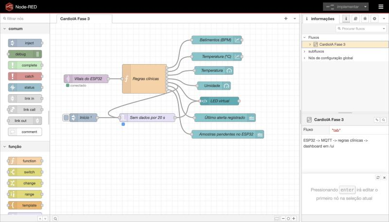
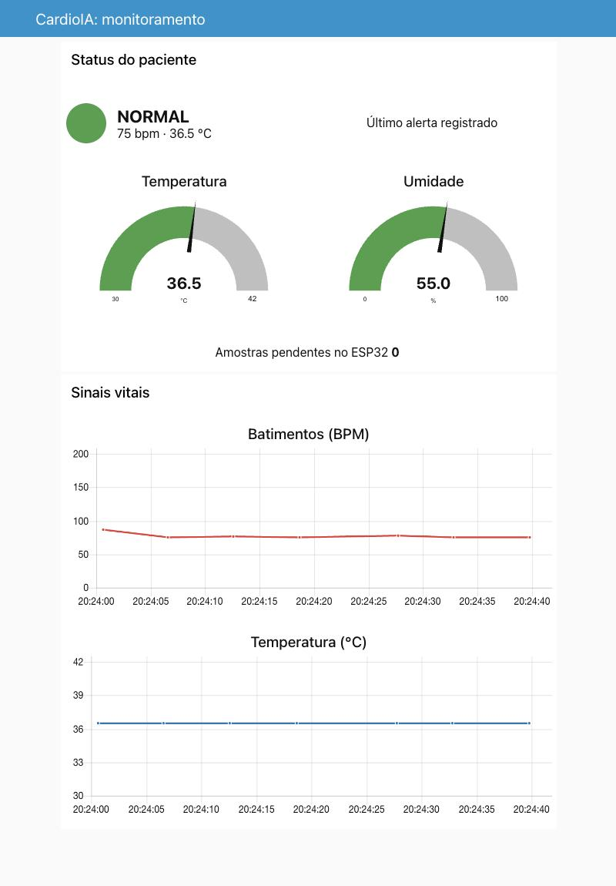
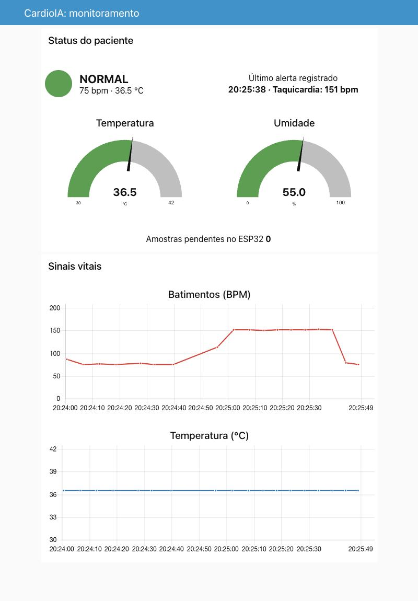
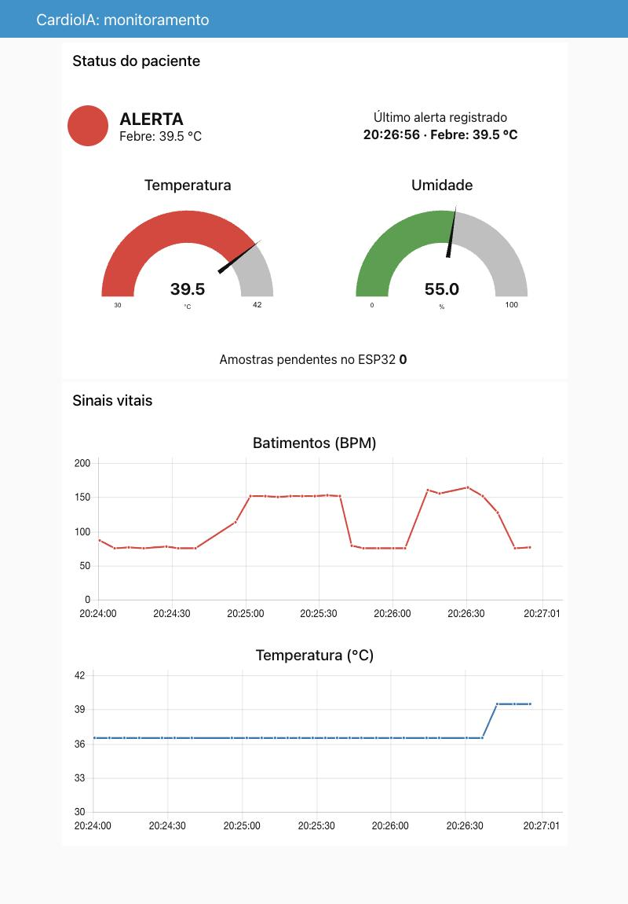
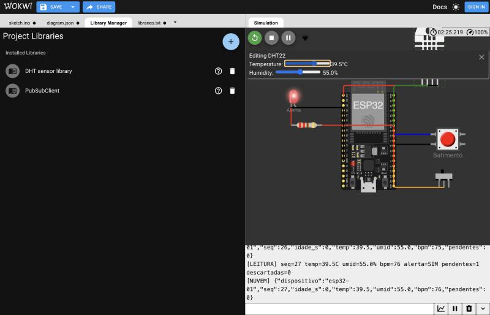

# CardioIA Fase 3 — Relatório da Parte 2: MQTT e dashboard

**Integrantes:** Gustavo Trindade Soares (RM567848) e João Pedro Nishikawa Alves (RM562376)

## 1. Visão geral da arquitetura

O sistema tem três camadas, cada uma com uma responsabilidade:

| Camada | Onde roda | Responsabilidade |
|---|---|---|
| Edge | ESP32 no Wokwi | Captura, buffer local, alerta por LED e publicação MQTT |
| Cloud | Broker público HiveMQ | Recebe as mensagens e as entrega a quem assina o tópico |
| Fog | Node-RED, no computador | Valida os dados, aplica as regras clínicas e exibe o dashboard |

O caminho completo de cada leitura é: **sensor → buffer → `publish` → broker → `mqtt in` → regras clínicas → dashboard**.

## 2. Fluxo de comunicação MQTT

MQTT é um protocolo de publicação e assinatura: o ESP32 não conhece o dashboard, e os dois só conhecem o broker e o tópico. Isso combina com dispositivos vestíveis, porque o protocolo é leve e o cabeçalho das mensagens é pequeno.

| Parâmetro | Valor |
|---|---|
| Broker | `broker.hivemq.com`, porta 1883 |
| Tópico | `cardioia/fase3-7f3a/esp32-01/vitais` |
| Publicador | ESP32 com a biblioteca PubSubClient, QoS 0 |
| Assinante | Nó `mqtt in` do Node-RED, QoS 0, saída JSON |
| Identificador do cliente | `cardioia-esp32-` + número aleatório, para evitar conflito no broker público |

O tópico segue a hierarquia `projeto/instância/dispositivo/medida`, o que permite incluir outros aparelhos sem mudar a estrutura. Exemplo real de mensagem, capturado durante a sincronização:

```
{"dispositivo":"esp32-01","seq":8,"idade_s":40,"temp":36.5,"umid":55.0,"bpm":151,"pendentes":8}
```

- `seq` é o número sequencial, que permite identificar lacunas.
- `idade_s` é a idade da leitura em segundos. O ESP32 não tem relógio de tempo real no projeto, então o Node-RED calcula o horário da medição subtraindo esse valor da hora atual.
- `pendentes` informa quantas amostras ainda estão no buffer.

**Sequência de conexão.** O Wi-Fi conecta à rede `Wokwi-GUEST` sem bloquear a coleta. Quando a variável `wifiConectado` é verdadeira e o MQTT está desconectado, o firmware tenta conectar a cada 5 s, com tempo limite de 2 s. Depois de conectado, publica uma amostra a cada 50 ms enquanto houver pendências. Um buffer cheio, com 4.000 amostras, leva cerca de 200 s para esvaziar nesse ritmo.

**Limitação do QoS 0.** A biblioteca PubSubClient publica apenas com QoS 0, ou seja, sem confirmação de entrega pelo broker. Um `publish` aceito significa que a mensagem saiu do ESP32, não que ela chegou. Em nossos testes não houve perda, e o campo `seq` permite detectar lacunas. Um produto real deveria usar QoS 1 e só apagar a amostra depois da confirmação.

## 3. Configuração do dashboard no Node-RED

O fluxo está em `node-red/flows.json` e usa o pacote `node-red-dashboard`. A figura abaixo mostra os nós e as conexões.



**Nó `mqtt in`.** Assina o tópico e converte o texto da mensagem em um objeto JSON.

**Função "Regras clínicas".** É o centro do fluxo e tem 7 saídas, uma para cada elemento do painel. Como o broker é público e qualquer pessoa pode publicar no tópico, ela primeiro valida os tipos e as faixas de valores de cada campo e descarta o que for inválido. Depois aplica os limites definidos pelo grupo:

| Condição | Resultado |
|---|---|
| BPM acima de 120 | ALERTA: taquicardia |
| BPM entre 1 e 49 | ALERTA: bradicardia |
| Temperatura acima de 38 °C | ALERTA: febre |
| BPM igual a 0 | SEM BATIMENTO (nenhum toque nos últimos 6 s) |
| Demais casos | NORMAL |

**Elementos do painel** (disponível em `http://127.0.0.1:1880/ui`):

| Elemento | Nó | Configuração |
|---|---|---|
| Gráficos de BPM e temperatura | `ui_chart` | Linha, janela de 30 min, com `msg.timestamp` igual ao horário da medição |
| Medidor de temperatura | `ui_gauge` | De 30 a 42 °C; muda de cor em 37,5 °C e 38 °C |
| Medidor de umidade | `ui_gauge` | De 0 a 100% |
| LED virtual | `ui_template` | Círculo verde, laranja, vermelho ou cinza, com texto do estado |
| Último alerta registrado | `ui_text` | Horário e motivo, inclusive de alertas ocorridos offline |
| Amostras pendentes | `ui_text` | Quantidade ainda no buffer do ESP32 |

**Amostras antigas e ao vivo.** Os medidores e o LED só usam leituras com até 15 s de idade, para que dados antigos não pareçam o estado atual do paciente. Os gráficos recebem todas as amostras, e um alerta ocorrido offline aparece em "Último alerta registrado" no horário em que aconteceu.

**Vigilância de dados.** Um nó `trigger` é reiniciado a cada leitura ao vivo. Se nada chegar por 20 s, o LED fica cinza com o texto "SEM DADOS". Sem isso, uma queda de conexão manteria na tela o último "NORMAL", passando uma falsa segurança.

## 4. Evidências

Os prints abaixo foram feitos com o firmware final rodando no Wokwi, enviando pelo broker público para o Node-RED local. Os toques foram gerados por um script temporizado para manter o ritmo constante, e a temperatura foi alterada pelo controle do DHT22 no simulador.

<pdf:nextpage />

<table>
<tr><th>Operação normal, com o LED verde</th><th>Depois da sincronização: taquicardia coletada offline entra no gráfico no horário certo, e o alerta fica registrado</th></tr>
<tr><td></td><td></td></tr>
</table>

<table>
<tr><th>Alerta automático de febre a 39,5 °C no dashboard</th><th>Mesmo momento no Wokwi: LED físico aceso</th></tr>
<tr><td></td><td></td></tr>
</table>

## 5. Segurança e boas práticas

O broker público foi escolhido porque dispensa cadastro e facilita a demonstração no Wokwi. A escolha tem custo: a conexão não é criptografada, não exige senha, e qualquer pessoa pode ler o tópico ou publicar nele. Por isso, o projeto só transmite dados fictícios, sem nome nem identificador de paciente, e o Node-RED valida toda mensagem recebida. O editor do Node-RED, que não tem senha, aceita conexões apenas do próprio computador.

Um produto real precisaria de broker privado, como o HiveMQ Cloud, com TLS na porta 8883, usuário e senha por dispositivo, regras de acesso por tópico e senhas fora do código. Também precisaria cumprir a LGPD, pois dados de saúde são dados pessoais sensíveis. Os limites clínicos usados aqui são didáticos e precisariam de validação médica, e o botão apenas simula um sensor cardíaco real.
